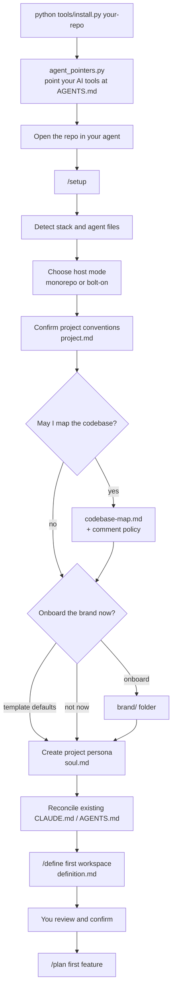

# aiworkspace harness

A drop-in, agent-agnostic workflow harness for AI-assisted development. Add it to any repository, run `setup`, and every AI agent working there (Claude Code, Codex, Gemini, Antigravity, …) follows the same gated lifecycle, guardrails, and skills.

Built on **Google's Open Knowledge Format (OKF v0.1)**: every rule, skill, and workspace document is plain Markdown with YAML frontmatter, so it is readable by humans and any agent alike.

---

## Quickstart

No checkout needed — this fetches a shallow clone to a temp directory, runs the installer, and cleans up:

```bash
curl -fsSL https://raw.githubusercontent.com/MigaelHartzenberg-Coder/aiworkspace/master/tools/bootstrap.sh \
  | sh -s -- https://github.com/MigaelHartzenberg-Coder/aiworkspace path/to/your-repo
```

```powershell
iex "& { $(irm https://raw.githubusercontent.com/MigaelHartzenberg-Coder/aiworkspace/master/tools/bootstrap.ps1) } -RepoUrl https://github.com/MigaelHartzenberg-Coder/aiworkspace -Target path\to\your-repo"
```

Add `--dry-run` to preview first. See [Install](#install) below for the from-a-checkout form, what gets written, and upgrading.

---

## What you get

- **A 6-step gated lifecycle** — `define` → `plan` → `resources/` → `processing/` → `finalized/` → `promote`. Agents never advance a step without explicit human approval.
- **A production immutability guardrail** — AI edits happen in a sandboxed `processing/` folder; only a human-issued `promote` touches production code.
- **A skills library** — engineering (codebase mapping, code review, testing, diagnosis, architecture), security audits, productivity (planning, personas, handoffs, context management), and brand onboarding on top of a Material Design 3 template.
- **Project context agents actually use** — a codebase map of where and how to change code, and a `soul.md` persona so agents write in your project's languages, patterns, and voice.
- **Domain workspaces** — each area of work gets its own identity, tone, directives, plans, and audit log.

---

## Install

Requires Python 3.8+ (standard library only) and git.

**Without a checkout**, `tools/bootstrap.sh` (macOS/Linux) and `tools/bootstrap.ps1` (Windows) fetch a shallow clone of this repository into a temp directory, run the installer, and delete the clone again:

```bash
curl -fsSL <raw-url-of-tools/bootstrap.sh> | sh -s -- <this-repo-url> path/to/your-repo --dry-run
```

```powershell
iex "& { $(irm <raw-url-of-tools/bootstrap.ps1>) } -RepoUrl <this-repo-url> -Target path/to/your-repo --dry-run"
```

Set `AIWORKSPACE_REPO_URL` (sh: env var: `AIWORKSPACE_REPO_URL=<this-repo-url>`; PowerShell: `$env:AIWORKSPACE_REPO_URL`) to drop the repo-url argument from every call — handy as a saved alias. Drop `--dry-run` to actually install.

**From a checkout** of this repository:

```bash
python tools/install.py path/to/your-repo --dry-run   # preview
python tools/install.py path/to/your-repo             # install
```

The installer writes:
- `aiworkspace/`: skills, the workspace template, and starter `host.md`/`project.md`/`index.md`.
- `.claude/skills/`: Claude Code slash-command adapters. Skills already in your repo are kept; a name clash is reported, not overwritten.
- `AGENTS.md` and `CLAUDE.md`: the harness rules go inside a `<!-- aiworkspace:start -->` … `<!-- aiworkspace:end -->` block. An existing file keeps its own content, and the block is appended below it.

Then, inside your repo:

```bash
python aiworkspace/scripts/agent_pointers.py   # pick the AI tools you use; each gets a "read AGENTS.md first" file
```

and open the repo in your agent and run **`/setup`**. See [Onboarding flow](#onboarding-flow) below.

### Pointing every AI tool at `AGENTS.md`

Each coding agent reads its *own* instruction file when a session starts, not necessarily `AGENTS.md`. If that file doesn't send it to `AGENTS.md`, the agent may never see the harness rules: no step gate, no immutability guardrail. `aiworkspace/scripts/agent_pointers.py` is the failsafe. It asks which tools you use, and writes a short "read `AGENTS.md` first" block into each tool's startup file:

| Tool | File written |
| :--- | :--- |
| Claude Code | `CLAUDE.md` (already written by the installer, so left as is) |
| Gemini CLI | `GEMINI.md` |
| GitHub Copilot | `.github/copilot-instructions.md` |
| Cursor | `.cursor/rules/aiworkspace.mdc` (`alwaysApply: true`) |
| Windsurf | `.windsurf/rules/aiworkspace.md` (`trigger: always_on`) |
| Cline | `.clinerules/aiworkspace.md` |
| OpenAI Codex | nothing needed (reads `AGENTS.md` natively) |
| Anything else | `--file path/to/its-instructions.md` |

```bash
python aiworkspace/scripts/agent_pointers.py                        # interactive menu
python aiworkspace/scripts/agent_pointers.py --tools gemini,cursor  # non-interactive (agents, CI)
python aiworkspace/scripts/agent_pointers.py --list                 # supported tools
```

Existing content in those files is kept; the pointer goes in the same marked block the installer uses, and re-running only refreshes it. Run it again whenever the team adopts another AI tool. `/setup` also offers it (step 7).

### Why an installer, and not just asking the AI?

Getting the harness into a repo has two parts, and each is done by the tool that suits it:

| Part | Done by | Why |
| :--- | :--- | :--- |
| **Copy the files**, and later upgrade them | `tools/install.py` | Mechanical and exact. It needs no judgment, so it shouldn't need an agent. |
| **Fit the harness to your project** | The AI, via `/setup` | Needs judgment and conversation: your stack, conventions, brand, persona, first workspace. |

You *could* ask an agent to copy the harness in, and the first install would mostly work. The installer is still needed because:

- **Upgrades need memory.** The installer records a hash for every file it writes in `aiworkspace/.harness-manifest.json`, so on the next run it can tell which files are its own and untouched (safe to update), which you edited (left alone and reported), and which the harness has since removed (safe to delete). An agent has no such record. On an upgrade it would either overwrite your edits or leave stale files behind.
- **The result is identical every time.** Over 100+ files, an agent may skip a file, paraphrase a rule, or reorganize something. The installer copies byte-for-byte.
- **Your files are protected.** Existing `AGENTS.md`/`CLAUDE.md` content stays outside the managed block, and a skill of yours with the same name as a harness command (e.g. your own `/plan`) is reported, not replaced.
- **You can preview it.** `--dry-run` lists every change before anything is written.
- **It's fast and free.** It takes about a second, costs no tokens, needs no permission prompts, and also runs in CI or a plain terminal.
- **Nothing governs the AI yet.** Before install, the rules that keep an agent careful aren't in the repo.

The AI is better at merging *meaning*, e.g. noticing that your existing `CLAUDE.md` says "use npm" while you want pnpm. That's why reconciling agent files is a `/setup` step, not an installer feature. You can also ask your agent to run the installer for you ("run `python tools/install.py ../my-repo --dry-run` and show me"). You keep the installer's guarantees and the agent does the typing.

### Upgrading

Pull the latest harness and run the same command again. `aiworkspace/.harness-manifest.json` records every file the installer wrote, along with its hash, so an upgrade:
- updates or removes harness files you haven't touched;
- reports harness files you **edited** as conflicts and leaves them alone (re-run with `--force` to overwrite);
- replaces only the marked block in `AGENTS.md`/`CLAUDE.md`;
- never touches your project files: `host.md`, `project.md`, `index.md`, workspaces, `brand/`, `codebase-map.md`, `soul.md`.

The installer exits with `1` when there are conflicts, and with `2` on errors (e.g. stale adapters in the harness checkout).

### Host modes

| Mode | Use when | Production code lives in |
| :--- | :--- | :--- |
| `monorepo` | New repo, or one already organized as `apps/<name>/` | `apps/<workspace>/` |
| `bolt-on` | Existing codebase with its own structure | Wherever each workspace's **Production Target Map** says |

---

## Onboarding flow

From an empty install to your first planned feature:



### What `/setup` asks and writes

Every step proposes an answer from what it finds in the repo. You confirm or correct it, and the optional steps can be skipped.

| # | Step | You're asked | Written to | Skippable |
| :--- | :--- | :--- | :--- | :--- |
| 1 | Detect host context | — (reads manifests, lockfiles, CI, existing agent files) | — | — |
| 2 | Host mode | `monorepo` or `bolt-on`? | `aiworkspace/host.md` | No |
| 3 | Project conventions | Confirm the name, purpose, stack, package manager, build/lint/test commands, and project-wide rules | `aiworkspace/project.md` | No |
| 4 | Codebase map | **Permission to read the code** (read-only, no secrets or dependency folders); a comment policy if the code has no consistent scheme | `aiworkspace/codebase-map.md` | Yes (`declined`) |
| 5 | Brand | Onboard now, use template defaults, or not now. If onboarding: brand files, colors, fonts, logos, UI stack | `aiworkspace/brand/` | Yes (defaults, or ask again at the first UI task) |
| 6 | Project persona | Only what the map and conventions didn't answer: voice, values, patterns to use or avoid | `aiworkspace/soul.md` | Yes (`declined`) |
| 7 | Reconcile agent files | Approve fixes where your existing `CLAUDE.md`/`AGENTS.md` contradicts the harness; which AI tools you use | your `CLAUDE.md`/`AGENTS.md` (only with approval); each tool's startup file via `agent_pointers.py` | Only if nothing conflicts |
| 8 | Workspaces | One workspace or several? In `bolt-on` mode, where should each kind of code land? | — (feeds step 9) | No |
| 9 | First workspace | `/define` interview: purpose, scope, users, success criteria, directives, production target, first features | `aiworkspace/workspaces/<name>/` | No |
| 10 | Review | Confirm everything written and skipped | — | No |

Nothing in your production code is changed during setup. Everything is written inside `aiworkspace/`, apart from step 7, and that only with your approval.

### After onboarding

- **Day to day:** `/plan` a feature → `/resources` → `/process` (or `/process auto` to run every remaining task in one approved pass) → `/finalize` → `/promote`. Each step stops for your go-ahead.
- **Another area of work:** `/define` a new workspace. `/plan` also offers this when an ask doesn't fit an existing one.
- **Changing your mind later:** `/map` refreshes the codebase map, `/brand` onboards or changes the brand, and `/persona` edits the project or a workspace persona.
- **Upgrading the harness:** re-run the installer (see [Upgrading](#upgrading)). Your project files and workspaces are never touched.

---

## The lifecycle

```text
[0: define] ──> [1: plan] ──> [2: resources/] ──> [3: processing/] ──> [4: finalized/] ──> [5: promote] ──> [production]
 workspace core   feature/tasks   input context      active iteration     audited & gated     human-only
```

| Step | Command | What happens |
| :--- | :--- | :--- |
| — | `/map` | Create or refresh the codebase map (`codebase-map.md`) |
| — | `/brand` | Onboard or change the brand (`brand/`), or choose template defaults |
| — | `/persona` | Create or change the project or a workspace persona (`soul.md`) |
| 0 | `/define` | Create a workspace and define its core (`definition.md`). Alias `/spec` |
| 1 | `/plan` | Plan a feature/change as an ordered task list (defines the workspace first if needed) |
| 2 | `/resources` | Collect the context, schemas, and data the plan calls for |
| 3 | `/process` | Work through the plan's tasks inside `processing/`, one round at a time; `/process auto` runs all remaining tasks in one approved pass |
| 4 | `/finalize` | Security audit, API spec (if applicable), docs, tests, dual-axis code review |
| 5 | `/promote` | Human-authorized copy to production |

Full specification: [`aiworkspace/README.md`](./aiworkspace/README.md).

---

## Layout

```text
.
├── AGENTS.md                     # Agent-agnostic operating rules (source of truth)
├── CLAUDE.md                     # Claude Code pointer to AGENTS.md
├── .claude/skills/               # Generated Claude Code slash-command adapters (/plan, /spec, …)
├── tools/                        # Harness maintenance scripts (not copied into host repos)
└── aiworkspace/
    ├── README.md                 # Architecture, lifecycle & slash-command spec
    ├── index.md                  # Registry of workspaces & skills (filled as you go)
    ├── host.md                   # host_mode — written by setup
    ├── project.md                # Project conventions — written by setup
    ├── codebase-map.md           # Where/how to change code — setup, with permission
    ├── brand/                    # Brand values, logos, fonts, tokens, docs & references — /brand (optional)
    ├── soul.md                   # Project persona — /persona
    ├── scripts/                  # Shipped helper scripts (agent_pointers.py)
    ├── skills/                   # design / engineering / productivity / security
    └── workspaces/
        └── template-workspace/   # Boilerplate copied by /define
```

---

## Maintaining the harness

The "Slash Commands & Aliases" table in [`aiworkspace/README.md`](./aiworkspace/README.md) is the single source of truth for commands. The Claude Code adapters in `.claude/skills/` are generated from it, so never edit them by hand:

```bash
python tools/gen_claude_adapters.py          # regenerate after editing the table or a skill description
python tools/check_harness.py                # links, leftover names, adapters in sync — exit 1 on any problem (use in CI)
python -m unittest discover tools            # tests for the tools themselves
```

Adapter behavior:
- Primary commands carry the canonical skill's description, so Claude can also pick them up from plain-language requests.
- Aliases, `/finalize`, and `/promote` set `disable-model-invocation: true`. Only a human typing the command runs them (Directive #7).
- `/plan` intentionally replaces Claude Code's built-in plan-mode command in the terminal. Plan mode is still available with Shift+Tab.

### Why the checks are needed

The harness is plain Markdown that agents follow literally, so mistakes that are harmless in normal docs become behavior bugs here:

- **A broken link is a missing instruction.** When `AGENTS.md` tells an agent to "follow `skills/x/SKILL.md`" and that file doesn't exist, the agent improvises or silently skips the step. The link check catches this before it ships to every repo the harness is installed in.
- **A leftover name leaks the old project into every new one.** The harness was extracted from a real project. One forgotten "use <old company>'s palette" rule or `apps/<old-app>/` path would send agents in an unrelated repo after a brand and folders that don't exist. Absolute paths like a home directory break on every other machine.
- **Stale adapters make commands disagree.** If the command table changes but `.claude/skills/` isn't regenerated, `/name` in Claude Code runs something different from what the docs (and other agents) say. The installer also refuses to ship stale adapters.

Run `python tools/check_harness.py` before committing changes to the harness, and in CI on every push.

`check_harness.py` runs three checks:
- **links**: every relative Markdown link and image resolves (code blocks, inline code, and external URLs are skipped).
- **leftovers**: no names from the project the harness was extracted from, and no absolute file URLs or user home-directory paths. The denylist is `LEFTOVER_PATTERNS` in the script. Keep it specific: generic technologies used as examples in skills (Flask, BigQuery, …) are fine.
- **adapters**: `.claude/skills/` matches the command table (same as `gen_claude_adapters.py --check`).
