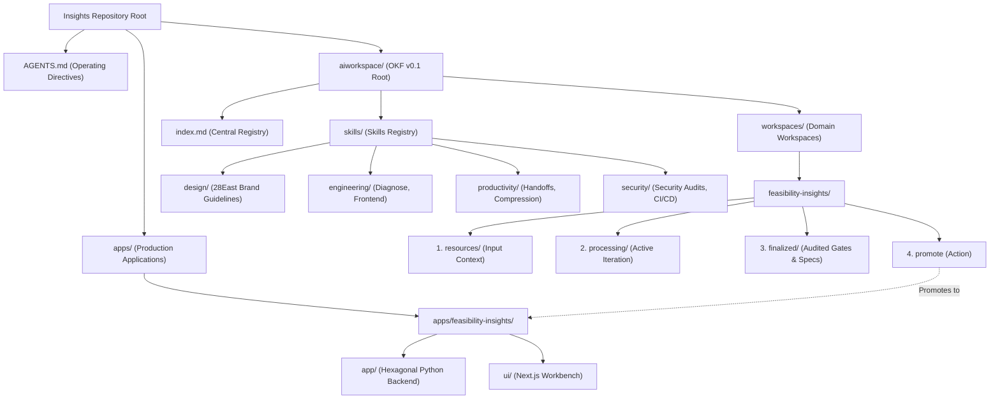

# Insights Project

Welcome to the **Insights** repository. This project is built on **Google's Open Knowledge Format (OKF v0.1)** and a **4-Stage Lifecycle Pipeline** to develop, audit, and deploy domain-driven AI knowledge systems and applications.

---

## 🏛️ System Architecture

The repository is structured around a strict separation between AI Domain Knowledge (`aiworkspace/`), Reusable Project Skills (`aiworkspace/skills/`), and Canonical Production Applications (`apps/`).



---

## 🔄 The 4-Stage Lifecycle Pipeline

All application development and domain knowledge generation follow a 4-step lifecycle:

```text
[Step 1: resources/] ──> [Step 2: processing/] ──> [Step 3: finalized/] ──> [Step 4: promote] ──> [apps/<workspace>/]
  (Input Context)           (Active Iteration)         (Audited Gates & Specs)      (Human Deployment)       (Production Application)
```

1. **`resources/` (Step 1 - Input Context)**: Contains raw inputs, specifications, BigQuery schemas, and context required for the domain task.
2. **`processing/` (Step 2 - Active Iteration)**: Active development environment where AI and human developers iterate, build features, and write tests.
3. **`finalized/` (Step 3 - Verification Gates & Audit)**: Audited stage. Moving code here requires passing four mandatory gates:
   - 🛡️ **Security Audit Checks** (`ci-cd-security-review`, `security-code-audit`) logged in `log.md`.
   - 📖 **OpenAPI Specs Generation** (`openapi.json` for REST APIs).
   - 📄 **Production Documentation** (Master architecture diagrams & specs).
   - 🧪 **System Verification & Tests** (Compilation, linting, and test suites).
4. **`promote` (Step 4 - Production Deployment)**: Human-triggered command that deploys audited code from `finalized/` to canonical production in `apps/<workspace>/`.
   - Populates `apps/<workspace>/README.md` as a standalone master guide.
   - Updates this root [`README.md`](./README.md) to add or update the application entry in the directory structure and quick links navigation table.
   - Updates `aiworkspace/index.md` to point to `apps/<workspace>/` as the canonical production application location.

---

## 🔒 Immutability Guardrail & Production Apps (`apps/`)

- **Strict Immutability Rule**: No AI agent or automated assistant may directly edit code inside `apps/[workspace]`.
- **Development Workflow**: All feature requests, fixes, and updates are developed in `aiworkspace/workspaces/[workspace]/processing/` and moved through `finalized/` before human-authorized promotion to `apps/[workspace]`.
- **Standalone Production README Standard**: Every production app in `apps/<workspace>/` includes a standalone master guide (`README.md`) with developer setup instructions, complete environment variable tables, and inline `.env.template` definitions.
- **Root README Synchronization**: Upon executing `promote`, the model must update this root [`README.md`](./README.md) to register the newly promoted application entry.

---

## 🎨 Design & Package Standards

- **Brand Compliance**: User interfaces follow the official **28East Brand Guidelines** ([`aiworkspace/skills/design/brand-guidelines/`](./aiworkspace/skills/design/brand-guidelines/SKILL.md)).
- **Typography**: Default web typography uses **`Roboto`** (`Roboto`, `Google Sans`, `Inter`).
- **Color Palette**: Dark Navy (`#0A1128`), Container Slate (`#0B192C`), Brand Red (`#E31B23`), Slate Grey (`#414A51`), Premier Blue (`#1A73E8`), Signal Green (`#34A853`).
- **Package Manager**: Mandatory usage of **`pnpm`** across all Node.js / Next.js / frontend projects.

---

## 📁 Repository Directory Layout

```text
.
├── AGENTS.md                           # Core AI agent instructions & operating guardrails
├── README.md                           # Root repository documentation (This file)
├── requirements.txt                    # Top-level Python dependencies
├── apps/                               # Canonical production applications
│   └── feasibility-insights/           # Feasibility Insights production app
│       ├── README.md                   # Standalone production guide & inline .env.template
│       ├── app/                        # Python backend service (Hexagonal Architecture)
│       └── ui/                         # Next.js Fine-Tuning Studio & Workbench
└── aiworkspace/                        # OKF v0.1 Knowledge Base Root
    ├── README.md                       # AI Workspace architecture & route specifications
    ├── index.md                        # Central registry for workspaces & skills
    ├── skills/                         # Integrated Skills Registry
    │   ├── README.md                   # Skills index & usage rules
    │   ├── design/                     # 28East brand guidelines skill & assets
    │   ├── engineering/                # Diagnostic & frontend design skills
    │   ├── productivity/               # Workflow, handoff & skill authoring skills
    │   └── security/                   # Security review & code audit skills
    └── workspaces/                     # Domain Workspaces
        ├── template-workspace/         # Starter template for new domain workspaces
        └── feasibility-insights/       # Feasibility Insights domain workspace
            ├── index.md                # Domain entry point, identity & production pointer
            ├── log.md                  # Chronological lifecycle & security audit log
            ├── resources/              # Step 1: Schemas, logs, PDF reports & source data
            ├── processing/             # Step 2: Active dev iteration workspace
            └── finalized/              # Step 3: Audited code, OpenAPI specs & test logs
```

---

## 🚀 Navigation & Quick Links

| Resource | Path | Description |
| :--- | :--- | :--- |
| **Agent Directives** | [`AGENTS.md`](./AGENTS.md) | Operating rules, identity standards, and guardrails |
| **Workspace Spec** | [`aiworkspace/README.md`](./aiworkspace/README.md) | OKF v0.1 architecture & 4-step pipeline guide |
| **Central Registry** | [`aiworkspace/index.md`](./aiworkspace/index.md) | Central registry of domain workspaces & skills |
| **Skills Registry** | [`aiworkspace/skills/README.md`](./aiworkspace/skills/README.md) | Master index of available project AI skills |
| **Feasibility Domain** | [`aiworkspace/workspaces/feasibility-insights/index.md`](./aiworkspace/workspaces/feasibility-insights/index.md) | Active domain entry point & domain instructions |
| **Production App** | [`apps/feasibility-insights/README.md`](./apps/feasibility-insights/README.md) | Feasibility Insights production deployment guide |
