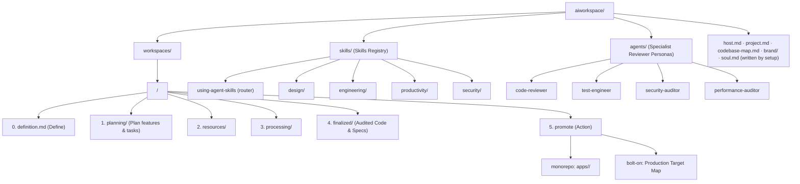

# AI Workspace & Open Knowledge Format (OKF)

This folder hosts domain-specific AI knowledge workspaces and AI skills built on **Google's Open Knowledge Format (OKF v0.1)** and a **6-Step Lifecycle Architecture**. It provides a standardized, vendor-neutral, agent- and human-friendly structure for input context, generated content, human iteration, audited output, and the skills agents use along the way.

It is installed into a host repository and configured by [`productivity/setup`](./skills/productivity/setup/SKILL.md), which records:
- [`host.md`](./host.md) — `host_mode`: where production code lives (`monorepo` → `apps/<workspace>/`; `bolt-on` → per-workspace Production Target Map).
- [`project.md`](./project.md) — this project's stack, commands, comment policy, context-file status, and project-specific directives.
- `codebase-map.md` — map of the host codebase: where and how to make changes (written by [`engineering/codebase-map`](./skills/engineering/codebase-map/SKILL.md), with permission).
- `brand/` — the brand folder: `brand.md` (values, UI technology, file manifest) plus logos, fonts, tokens, source docs, and reference artifacts (written by [`design/brand-onboarding`](./skills/design/brand-onboarding/SKILL.md); absent → template defaults).
- `soul.md` — the project persona agents adopt (written by [`productivity/persona`](./skills/productivity/persona/SKILL.md)); workspaces may layer their own.

---

## 🎯 Core Agent Directives & Production Guardrails

All agents working in `aiworkspace/` are bound by [`AGENTS.md`](../AGENTS.md). In short:
1. **Never Assume Anything**: If unsure or underspecified, ask the user.
2. **Never Hallucinate**: Be precise, concise, and accurate, backed by references/rationale.
3. **Persona & Domain Identity**: Agents adopt `soul.md` (project, with the workspace's `soul.md` layered on top) for voice and code style; each workspace's `index.md` holds its purpose, directives, and glossary. Rules always win over persona.
4. **STRICT IMMUTABILITY GUARDRAIL (host-mode aware)**:
   - `monorepo`: no AI edits inside `apps/[workspace]` except through a human-requested `promote`.
   - `bolt-on`: no AI edits outside `aiworkspace/` except through a human-requested `promote` into the workspace's Production Target Map.
   - All code development, refactoring, and feature work MUST occur in `aiworkspace/workspaces/[workspace]/processing/`.
5. **PRODUCTION README RULE (`monorepo`)**: During `promote`, `apps/[workspace]/README.md` must be a standalone guide (setup, environment variables, inline `.env.template` if the app has one), and the root `README.md` must be updated to list the app.
6. **STRICT EXPLICIT HUMAN APPROVAL FOR STEP TRANSITIONS**:
   - AI agents MUST NEVER automatically transition work between pipeline steps.
   - Pause after completing work in a step, report results, and **WAIT for explicit instruction before moving on**.

---

## 🏛️ Architecture Overview

1. **Domain Workspaces (`aiworkspace/workspaces/`)**: Work partitioned into a 6-step lifecycle (`define` ➔ `plan` ➔ `resources` ➔ `processing` ➔ `finalized` ➔ `promote`). New workspaces are created by `define`, which copies `workspaces/template-workspace/`.
2. **AI Skills Registry (`aiworkspace/skills/`)**: Skills categorized and formatted as OKF documents (`type: skill`). [`skills/using-agent-skills`](./skills/using-agent-skills/SKILL.md) is the router: consult it first when it isn't obvious which skill (or specialist agent) a task needs.
3. **Specialist Agents (`aiworkspace/agents/`)**: Fresh, isolated reviewer personas (`type: agent`) — code-reviewer, test-engineer, security-auditor, performance-auditor — spawned for a second opinion. Each one loads skills from the registry above rather than duplicating them. See [`agents/README.md`](./agents/README.md).
4. **Production**: wherever `host.md` says — `apps/<workspace>/` or the host repo's own paths — written only by a human-approved `promote`.



---

## ⚡ Skills (`aiworkspace/skills/`)

Every skill is an OKF document (`type: skill`) with structured YAML frontmatter.

- **Master Skills Index**: [`skills/README.md`](./skills/README.md)
- **Router**: [`skills/using-agent-skills`](./skills/using-agent-skills/SKILL.md) — a top-level meta-skill (not inside any category) that maps task shape to the skill (or specialist agent) to load.
- **Onboarding a repository**: [`productivity/setup`](./skills/productivity/setup/SKILL.md)
- **Categories**:
  - [`skills/design/README.md`](./skills/design/README.md) (Brand guidelines & brand onboarding)
  - [`skills/engineering/README.md`](./skills/engineering/README.md) (Codebase map, review, testing, debugging, architecture, frontend)
  - [`skills/productivity/README.md`](./skills/productivity/README.md) (Lifecycle, onboarding, persona, handoffs, skill authoring)
  - [`skills/security/README.md`](./skills/security/README.md) (CI/CD security & code audits)

---

## 🕵️ Specialist Agents (`aiworkspace/agents/`)

Fresh, isolated reviewer personas (OKF `type: agent`) spawned for a second opinion — someone who "wasn't in the room" when the code was written. Each one loads and uses skills from the registry above rather than duplicating their content.

- **Registry**: [`agents/README.md`](./agents/README.md)
- **Roster**: `code-reviewer` (loads `engineering/code-review`), `test-engineer` (loads `engineering/testing` + `test-first`), `security-auditor` (loads the applicable `security/*` skills), `performance-auditor` (loads `engineering/web-performance-audit`)
- **When to spawn one vs. load a skill directly**: load a skill yourself when you're the one doing the work; spawn an agent when you want an independent second opinion that isn't biased by having written the change. See [`skills/using-agent-skills`](./skills/using-agent-skills/SKILL.md) for the full decision table.

---

## 🔄 The 6-Step Lifecycle Pipeline

```text
[0: define] ──> [1: plan] ──> [2: resources/] ──> [3: processing/] ──> [4: finalized/] ──> [5: promote]
```

### Step 0: Define (`definition.md`)
- **Purpose**: Create a workspace and define its core. Driven by [`productivity/define`](./skills/productivity/define/SKILL.md) (`/define`, `/spec`).
- **Output**: `definition.md` at the workspace root (purpose, scope, users, success criteria, directives, production target, known unknowns, candidate features), plus the core sections of `index.md` and a row in the registry.
- **Cadence**: Once per workspace; revised rarely (redefine mode lists the plans a redefine affects).

### Step 1: Plan (`planning/`)
- **Purpose**: Plan one feature, change, or batch of work inside a defined workspace. Driven by [`productivity/plan`](./skills/productivity/plan/SKILL.md) (`/plan`).
- **Output**: `planning/features/<slug>/plan.md` covering problem, solution, implementation decisions, an ordered **Tasks** checklist, **Resources Needed**, testing decisions, and out of scope.
- **Define first**: if the workspace doesn't exist or isn't defined, `plan` hands off to `define`. Asks outside the defined scope are flagged.
- **Rule**: `grill-me` always runs; `goal-driven` is only loaded if the user opts in.
- **Large/ambiguous work**: may use `planning/decisions/*.md` alongside the plan, as a file-native decision frontier (`status: open | blocked | resolved`, `blocked_by: [...]`).

### Step 2: `resources/` (Input Context & Specifications)
- **Purpose**: The input knowledge, schemas, API specs, and sample data listed in the plan's **Resources Needed** section.
- **Rule**: **If it is empty or lacks necessary context, ask the user before proceeding.**

### Step 3: `processing/` (Generation & Active Iteration)
- **Purpose**: Active workspace where code, drafts, and iterative content live.
- **Human In The Loop**: All modifications, reviews, and reframing by humans happen here.
- **Rule**: **Never move files to `finalized/` without explicit human instruction.**
- **Auto mode**: `/process auto` runs every remaining task in one pass after a single upfront approval, still test-driven and ticked off one at a time, halting immediately on failure or an undecidable task. See [`productivity/process`](./skills/productivity/process/SKILL.md).

### Step 4: `finalized/` (Audit, Verification Gates & Code Transfer)
- **Trigger**: ONLY when explicitly instructed by the human.
- **Purpose**: Holds audited, production-ready output, API specs, security logs, review results, and test verification.
- **Gates**: Content moves from `processing/` only after passing every applicable gate. A gate that does not apply is logged as `N/A` with a reason — never silently skipped:
  1. **🛡️ Security Audit** *(always)*: Run the relevant security skills and log findings in `log.md`.
  2. **📖 API Specification** *(only if an HTTP/REST API is exposed or changed)*: OpenAPI 3.x spec.
  3. **📄 Production-Ready Documentation** *(always)*: READMEs, plus architecture/deployment notes where warranted.
  4. **🧪 Verification & Tests** *(always)*: The build/lint/test commands from [`project.md`](./project.md). If no test suite exists, record what verification was done instead.
- **Evidence rule**: every `PASS` logged against a gate must cite the evidence that earned it (test output, build log excerpt, the file/section reviewed, the audit findings file) — an uncited `PASS` is itself a `FAIL`, and no check may be silenced or skipped to force a green run.
- Plus the dual-axis [`engineering/code-review`](./skills/engineering/code-review/SKILL.md), persisted to `finalized/review.md`, checked against the plan's Constraints section as well as its Tasks.

### Step 5: `promote` (Human Authorization & Production Deployment)
- **Trigger**: ONLY when explicitly requested by the human. Driven by [`productivity/promote`](./skills/productivity/promote/SKILL.md).
- **`monorepo`**: copies `finalized/` into `apps/<workspace>/`, writes its standalone `README.md`, and updates the root `README.md`.
- **`bolt-on`**: copies each `finalized/` file to its destination in the workspace's Production Target Map; any unmapped file stops the promote until the human maps it.
- **Both**: updates `aiworkspace/index.md` with the production location and clears temporary files in `resources/` and `processing/`.

---

## 📁 Directory Layout

```text
<host repo>/
├── AGENTS.md                          # Agent operating rules & guardrails
├── CLAUDE.md                          # Claude Code pointer to AGENTS.md
├── apps/                              # monorepo mode only
│   └── <workspace>/                   # Production code (written only by 'promote')
│       └── README.md                  # Standalone production guide
└── aiworkspace/
    ├── README.md                      # Architecture & specs (this file)
    ├── index.md                       # Registry of workspaces & skills
    ├── host.md                        # host_mode (written by setup)
    ├── project.md                     # Project conventions (written by setup)
    ├── codebase-map.md                # Where/how to change host code (setup, with permission)
    ├── brand/                         # Brand (brand onboarding / /brand; optional)
    │   ├── brand.md                   # Values, UI tech & manifest of every file below
    │   ├── logos/                     # Logo variants, favicons
    │   ├── fonts/                     # Self-hosted font files & licenses
    │   ├── tokens/                    # Supplied/exported design tokens
    │   ├── docs/                      # Source brand documents (guidelines PDF, voice & tone)
    │   └── references/                # Artifacts: mockups, screenshots, moodboards, approved designs
    ├── soul.md                        # Project persona (/persona)
    ├── skills/                        # using-agent-skills (router) / design / engineering / productivity / security
    ├── agents/                        # Specialist reviewer personas (code-reviewer, test-engineer, security-auditor, performance-auditor)
    └── workspaces/
        ├── template-workspace/        # Boilerplate copied by /define
        └── <domain>/
            ├── index.md               # Purpose, directives, glossary, production pointer / Target Map
            ├── definition.md          # Step 0: workspace core (written by /define)
            ├── soul.md                # Optional workspace persona (layers over project soul)
            ├── log.md                 # Chronological audit & lifecycle log
            ├── planning/              # Step 1: features/<slug>/plan.md, research, decision maps
            ├── resources/             # Step 2: source context, schemas, specs
            ├── processing/            # Step 3: active iteration
            └── finalized/             # Step 4: audited output, specs, review.md, test results
```

---

## 📄 OKF (Open Knowledge Format) Document Spec

Every document across `skills/`, `resources/`, `processing/`, and `finalized/` is a **Concept**: Markdown with **YAML Frontmatter**.

```yaml
---
type: skill | agent | dataset | table | metric | playbook | api | domain | resource | plan  # REQUIRED
scope: workspace | feature                                            # For type: plan only
name: skill-identifier                                                 # For skills/agents
title: Human-readable Title                                            # Recommended
description: Concise description of the concept                         # Recommended
status: draft | processing | finalized                                  # Recommended
tags: [analytics, customer, key-metric]                                # Optional
timestamp: 2026-09-09T13:45:03+02:00                                    # Optional (ISO-8601)
---
```

**`## Rationalizations` (optional section)**: any `type: skill` or `type: domain` document whose process has a step agents are tempted to skip, rush, or silently weaken may include a table of `Excuse | Why it's wrong | Do this instead`, placed right after the document's trigger/intro. See [`productivity/write-a-skill`](./skills/productivity/write-a-skill/SKILL.md).

---

## 🗺️ Routes & Navigation Conventions

| Target Entity | Route | Description |
| :--- | :--- | :--- |
| **Workspace Registry** | `aiworkspace/index.md` | All domain workspaces and skills |
| **Workspace Spec** | `aiworkspace/README.md` | Architecture and route documentation |
| **Host Config** | `aiworkspace/host.md` | `host_mode` |
| **Project Conventions** | `aiworkspace/project.md` | Stack, commands, comment policy, context-file status, project directives |
| **Codebase Map** | `aiworkspace/codebase-map.md` | Where and how to change host code |
| **Brand** | `aiworkspace/brand/` | `brand.md` + brand files & artifacts (absent → template defaults) |
| **Project Persona** | `aiworkspace/soul.md` | Voice, code style, values — project-wide |
| **Workspace Persona** | `aiworkspace/workspaces/<domain>/soul.md` | Optional per-workspace overrides |
| **Skills Registry** | `aiworkspace/skills/README.md` | All available skills |
| **Skills Router** | `aiworkspace/skills/using-agent-skills/SKILL.md` | Task shape → skill/agent to load |
| **Specialist Agents Registry** | `aiworkspace/agents/README.md` | Fresh-subagent reviewer personas |
| **Domain Entrypoint** | `aiworkspace/workspaces/<domain>/index.md` | Identity, instructions, production pointer |
| **Domain Log** | `aiworkspace/workspaces/<domain>/log.md` | Audit & change log |
| **Step 0 - Define** | `aiworkspace/workspaces/<domain>/definition.md` | Workspace core definition |
| **Step 1 - Plan** | `aiworkspace/workspaces/<domain>/planning/` | Feature plans & tasks, research, decision maps |
| **Step 2 - Resources** | `aiworkspace/workspaces/<domain>/resources/` | Input context and schemas |
| **Step 3 - Processing** | `aiworkspace/workspaces/<domain>/processing/` | Active iteration |
| **Step 4 - Finalized** | `aiworkspace/workspaces/<domain>/finalized/` | Audited output, specs, logs, test results |
| **Step 5 - Promote** | `promote` action | `apps/<workspace>/` (monorepo) or Target Map (bolt-on) |

---

## ⌨️ Slash Commands & Aliases (Canonical List)

Every command is a faster on-ramp into the same skill content above, never a replacement for natural-language requests. This table is the single source of truth for aliases; `AGENTS.md` Directive #9 and any tool-specific adapters (e.g. `.claude/skills/<name>/SKILL.md`) reference it rather than re-listing it.

| Stage | Primary | Aliases | Delegates to |
| :--- | :--- | :--- | :--- |
| Onboarding | `/setup` | — | [`skills/productivity/setup/SKILL.md`](./skills/productivity/setup/SKILL.md) |
| Codebase map | `/map` | `/remap` | [`skills/engineering/codebase-map/SKILL.md`](./skills/engineering/codebase-map/SKILL.md) |
| Brand | `/brand` | — | [`skills/design/brand-onboarding/SKILL.md`](./skills/design/brand-onboarding/SKILL.md) |
| Persona | `/persona` | `/soul` | [`skills/productivity/persona/SKILL.md`](./skills/productivity/persona/SKILL.md) |
| Step 0 — Define | `/define` | `/spec`, `/step0`, `/new-workspace` | [`skills/productivity/define/SKILL.md`](./skills/productivity/define/SKILL.md) |
| Step 1 — Plan | `/plan` | `/step1`, `/research` | [`skills/productivity/plan/SKILL.md`](./skills/productivity/plan/SKILL.md) |
| Step 2 — Resources | `/resources` | `/step2` | [`skills/productivity/resources/SKILL.md`](./skills/productivity/resources/SKILL.md) |
| Step 3 — Processing | `/process` (`auto` variant: `/process auto`) | `/step3`, `/processing` | [`skills/productivity/process/SKILL.md`](./skills/productivity/process/SKILL.md) |
| Step 4 — Finalize | `/finalize` | `/step4`, `/approve` | [`skills/productivity/finalize/SKILL.md`](./skills/productivity/finalize/SKILL.md) |
| Step 5 — Promote | `/promote` | `/step5`, `/deploy` | [`skills/productivity/promote/SKILL.md`](./skills/productivity/promote/SKILL.md) |

Every alias resolves to exactly the same skill as its primary — synonyms, not separate behaviors.

**Claude Code**: each primary and alias above has a generated adapter in `.claude/skills/<name>/SKILL.md`. After changing this table, regenerate them with `python tools/gen_claude_adapters.py` (harness repo only). In Claude Code, `/plan` replaces the built-in plan-mode command; plan mode stays on Shift+Tab.
