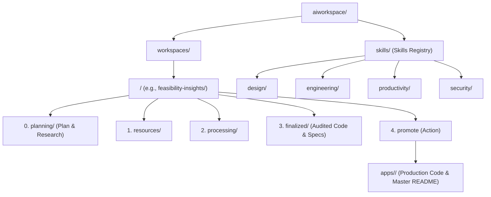

# AI Workspace & Open Knowledge Format (OKF)

This folder hosts domain-specific AI knowledge workspaces and project AI skills built on **Google's Open Knowledge Format (OKF v0.1)** and a **5-Step Lifecycle Architecture**. It provides a standardized, vendor-neutral, agent- and human-friendly directory structure for storing schemas, generated content, human modifications, audited production knowledge, specialized agent skills under `@aiworkspace`, and production code deployments under `apps/`.

---

## 🎯 Core Agent Directives & Production Guardrails

All agents interacting with `@aiworkspace` are bound by these core rules:
1. **Never Assume Anything**: If unsure or underspecified, ask the user.
2. **Never Hallucinate**: Be precise, concise, and accurate, backed by references/rationale.
3. **Domain Identity & Tone**: Each domain workspace defines its own tone, persona, guidelines, and domain instructions in its `index.md`.
4. **STRICT IMMUTABILITY GUARDRAIL FOR `apps/[workspace]`**:
   - No AI model can edit or modify code inside `apps/[workspace]` directly without human authorization via a `promote` step.
   - All code development, refactoring, and feature work MUST occur in `aiworkspace/workspaces/[workspace]/processing/`.
5. **STANDALONE PRODUCTION README & ROOT README UPDATE RULE**:
   - During `promote`, `apps/[workspace]/README.md` must be populated as a complete standalone production guide containing developer setup steps, environment variable tables, and the `.env.template` embedded inline as a copyable code block.
   - The root [`README.md`](../README.md) MUST also be updated to index the application entry in its directory tree and quick links navigation table.
6. **STRICT EXPLICIT HUMAN APPROVAL FOR STEP TRANSITIONS**:
   - AI agents MUST NEVER automatically transition work between pipeline steps (e.g. from `processing/` to `finalized/`, or from `finalized/` to `promote`/`apps/`).
   - The AI assistant MUST pause after completing work in a step, report results to the human user, and **WAIT for explicit instruction before moving to the next step**.

---

## 🏛️ Architecture Overview

The workspace is organized into two main roots and a canonical production application directory:
1. **Domain Workspaces (`aiworkspace/workspaces/`)**: Domain knowledge partitioned into a 5-stage lifecycle (`planning` ➔ `resources` ➔ `processing` ➔ `finalized` ➔ `promote`).
2. **AI Skills Registry (`aiworkspace/skills/`)**: Project available skills categorized and formatted as OKF concept documents (`type: skill`).
3. **Production Applications (`apps/`)**: Production code deployed via human-approved `promote` commands.



---

## ⚡ Project Skills (`aiworkspace/skills/`)

Skills provide specialized capabilities, workflows, and tool guidance. Every skill is an OKF document (`type: skill`) containing structured YAML frontmatter:

- **Master Skills Index**: [`aiworkspace/skills/README.md`](./skills/README.md)
- **Installing `aiworkspace` into another repository**: run `productivity/setup` ([`skills/productivity/setup/SKILL.md`](./skills/productivity/setup/SKILL.md)) once the files below are already present there. Getting the files onto a brand-new repo in the first place (e.g. a future `npx degit <org>/aiworkspace-template aiworkspace` one-liner) isn't built yet — that's a documented TODO, not a working command.
- **Categories**:
  - [`skills/design/README.md`](./skills/design/README.md) (Branding & Design)
  - [`skills/engineering/README.md`](./skills/engineering/README.md) (Debugging & Frontend)
  - [`skills/productivity/README.md`](./skills/productivity/README.md) (Handoffs, Compression, Skill Authoring)
  - [`skills/security/README.md`](./skills/security/README.md) (CI/CD Security & Code Audits)

---

## 🔄 The 5-Step Lifecycle Pipeline

Every workspace domain is partitioned into five dedicated stages:

### Step 0: `planning/` (Plan & Research)
- **Purpose**: Determine the shape of the work before `resources/` is populated. Driven by [`aiworkspace/skills/productivity/plan/SKILL.md`](./skills/productivity/plan/SKILL.md).
- **Two plan types**: a **Project Plan** (`planning/project-plan.md`, whole workspace, rare — triggered by `new-workspace`) or a **Feature/Change Plan** (`planning/features/<slug>/spec.md`, one unit of work, frequent).
- **Rule**: `grill-me` always runs; `goal-driven` is only loaded if the user opts in when asked — never auto-framed. Every plan gets an optional, recommended `## Goal` section first.
- **Large/ambiguous work**: may use `planning/decisions/*.md` instead of (or alongside) a single plan document — a file-native decision frontier (`status: open | blocked | resolved`, `blocked_by: [...]`), no issue tracker required.

### Step 1: `resources/` (Input Context & Specifications)
- **Purpose**: Contains all input knowledge, data schemas, API specs, metric definitions, and domain documentation required to start a task.
- **Rule**: Agents consult `resources/` first. **If `resources/` is empty or lacks necessary context, the agent must ask the user for context or required information before proceeding.**

### Step 2: `processing/` (Generation & Active Iteration)
- **Purpose**: Active workspace where application code, draft content, and iterative knowledge generation live.
- **Human In The Loop**: All modifications, reviews, and iterative reframing by humans occur here.
- **Rule**: Content remains in `processing/` throughout active development. **The agent MUST NOT copy or move files to `finalized/` without explicit human instruction.**

### Step 3: `finalized/` (Audit, Verification Gates & Code Transfer)
- **Trigger**: Executed ONLY when explicitly instructed by the human user.
- **Purpose**: Holds audited, production-ready application code, OpenAPI 3.0 specifications, security logs, and test verification results.
- **Validation Gates & Pre-requisites**: All content and application code are moved from `processing/` to `finalized/` ONLY AFTER executing and passing four mandatory gates:
  1. **🛡️ Security Audit Logging Checks**: Execute security audit skills and log findings in `log.md`.
  2. **📖 OpenAPI Specs Generation**: Create machine-readable `openapi.json` for all HTTP REST APIs.
  3. **📄 Production-Ready Documentation**: Generate master architecture diagrams, READMEs, and deployment specs.
  4. **🧪 Final System Verification & Tests**: Run compilation/syntax checks, test suites, and verify zero errors.

### Step 4: `promote` (Human Authorization & Production Deployment ➔ `apps/<workspace>/`)
- **Trigger**: Executed ONLY when explicitly requested by a human user.
- **Purpose**: Copies audited application code from `finalized/` into `apps/<workspace>/`.
- **Cleanup**: Removes temporary input context files in `resources/` and active iteration files in `processing/`.
- **Production README**: Populates `apps/<workspace>/README.md` as a complete, standalone master specification containing developer setup, environment variable tables, and the `.env.template` embedded inline.
- **Root README & Index**: Updates the root [`README.md`](../README.md) to register the promoted application entry and updates `aiworkspace/index.md` to point to `apps/<workspace>/` as the canonical location of production code.

---

## 📁 Workspace Directory Layout

```text
root/
├── AGENTS.md                          # AI Operating Rules & Guardrails
├── apps/
│   └── <workspace>/                   # Canonical Production Code (Deployed via 'promote')
│       ├── README.md                  # Master Production Guide & Inline .env.template
│       ├── app/                       # Backend Application Services
│       └── ui/                        # Next.js Fine-Tuning Studio
└── aiworkspace/
    ├── README.md                      # AI Workspace Architecture & Specs (This file)
    ├── index.md                       # Central registry indexing workspaces, skills & purposes
    ├── skills/                        # Project Available AI Skills (OKF Format)
    │   ├── README.md                  # Master Skills Index & Registry
    │   ├── design/                    # Design & Branding skills
    │   ├── engineering/               # Debugging & Frontend skills
    │   ├── productivity/              # Workflow & Utility skills
    │   └── security/                  # CI/CD & Code Security Audit skills
    └── workspaces/
        └── <domain>/                  # Domain Workspace (e.g., "feasibility-insights")
            ├── index.md               # Domain identity, tone, instructions & production pointer
            ├── log.md                 # Chronological audit & lifecycle log
            ├── planning/              # Step 0: Project/Feature plans, research, decision maps
            ├── resources/             # Step 1: Source context, schemas, APIs, specs
            ├── processing/            # Step 2: Generated content & active dev code
            └── finalized/             # Step 3: Audited code, OpenAPI specs, security logs, review.md & test results
```

---

## 📄 OKF (Open Knowledge Format) Document Spec

Every document across `skills/`, `resources/`, `processing/`, and `finalized/` represents a **Concept** formatted as standard Markdown with **YAML Frontmatter**.

### Frontmatter Schema

```yaml
---
type: skill | dataset | table | metric | playbook | api | domain | resource | plan  # REQUIRED
scope: project | feature                                              # For type: plan only
name: skill-identifier                                                 # For skills
title: Human-readable Title                                            # Recommended
description: Concise description of the concept                         # Recommended
status: draft | processing | finalized                                  # Recommended
tags: [analytics, customer, key-metric]                                # Optional
timestamp: 2026-09-09T13:45:03+02:00                                    # Optional (ISO-8601)
---
```

---

## 🗺️ Routes & Navigation Conventions

| Target Entity | Relative Route Pattern | Description |
| :--- | :--- | :--- |
| **Workspace Registry** | `aiworkspace/index.md` | Master index listing all domain workspaces and skills |
| **Workspace Spec** | `aiworkspace/README.md` | Architecture and route documentation |
| **Skills Registry** | `aiworkspace/skills/README.md` | Master index of available project AI skills |
| **Production Application** | `apps/<workspace>/` | Canonical production code location |
| **Production Master Guide** | `apps/<workspace>/README.md` | Standalone guide with setup & inline `.env.template` |
| **Domain Entrypoint** | `aiworkspace/workspaces/<domain>/index.md` | Primary domain index, identity, instructions & production pointer |
| **Domain Log** | `aiworkspace/log.md` | Audit & change log |
| **Step 0 - Planning** | `aiworkspace/workspaces/<domain>/planning/` | Project/Feature plans, research, decision maps |
| **Step 1 - Resources** | `aiworkspace/workspaces/<domain>/resources/` | Input context and schemas |
| **Step 2 - Processing** | `aiworkspace/workspaces/<domain>/processing/` | Intermediate generated content & active dev code |
| **Step 3 - Finalized** | `aiworkspace/workspaces/<domain>/finalized/` | Audited code, OpenAPI specs, security logs & test results |
| **Step 4 - Promote** | `promote` action | Human-triggered deployment to `apps/<workspace>/` |

---

## ⌨️ Slash Commands & Aliases (Canonical List)

Every stage also has a direct command form — a faster on-ramp into the exact same skill content described above, never a replacement for natural-language requests. This table is the single source of truth for the alias list; `AGENTS.md`'s universal slash-command directive and every `.claude/skills/<name>/SKILL.md` adapter reference it rather than re-listing it.

| Stage | Primary | Aliases | Delegates to |
| :--- | :--- | :--- | :--- |
| Step 0 — Planning | `/plan` | `/step0`, `/research` | [`skills/productivity/plan/SKILL.md`](./skills/productivity/plan/SKILL.md) |
| Step 1 — Resources | `/resources` | `/step1`, `/spec` | [`skills/productivity/resources/SKILL.md`](./skills/productivity/resources/SKILL.md) |
| Step 2 — Processing | `/process` | `/step2`, `/processing` | [`skills/productivity/process/SKILL.md`](./skills/productivity/process/SKILL.md) |
| Step 3 — Finalize | `/finalize` | `/step3`, `/approve` | [`skills/productivity/finalize/SKILL.md`](./skills/productivity/finalize/SKILL.md) |
| Step 4 — Promote | `/promote` | `/step4`, `/deploy` | [`skills/productivity/promote/SKILL.md`](./skills/productivity/promote/SKILL.md) |

Every alias resolves to exactly the same skill as its primary — these are synonyms, not separate behaviors.
