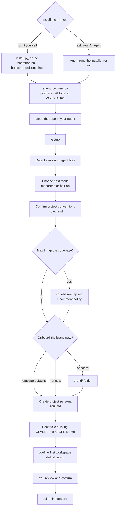

# Onboarding flow

From an empty install to your first planned feature:

## What `/setup` asks and writes

Every step proposes an answer from what it finds in the repo. You confirm or correct it, and the optional steps can be skipped.

| # | Step | You're asked | Written to | Skippable |
| :--- | :--- | :--- | :--- | :--- |
| 1 | Detect host context | — (reads manifests, lockfiles, CI, existing agent files) | — | — |
| 2 | Host mode | `monorepo` or `bolt-on`? | `aiworkspace/host.md` | No |
| 3 | Project conventions | Confirm the name, purpose, stack, package manager, build/lint/test commands, and project-wide rules | `aiworkspace/project.md` | No |
| 4 | Codebase map | **Permission to read the code** (read-only, no secrets or dependency folders); a comment policy if the code has no consistent scheme | `aiworkspace/codebase-map.md` | Yes (`declined`) |
| 5 | Brand | Onboard now, use template defaults, or not now. If onboarding: brand files, colors, fonts, logos, UI stack | `aiworkspace/brand/` | Yes (defaults, or ask again at the first UI task) |
| 6 | Project persona | Only what the map and conventions didn't answer: voice, values, patterns to use or avoid | `aiworkspace/soul.md` | Yes (`declined`) |
| 7 | Reconcile agent files | Approve fixes where your existing `CLAUDE.md`/`AGENTS.md` contradicts the harness; which AI tools you use | your `CLAUDE.md`/`AGENTS.md` (only with approval); each tool's startup file via `agent_pointers.py` | Only if nothing conflicts |
| 8 | Workspaces | One workspace or several? In `bolt-on` mode, where should each kind of code land? | — (feeds step 9) | No |
| 9 | First workspace | `/define` interview: purpose, scope, users, success criteria, directives, production target, first features | `aiworkspace/workspaces/<name>/` | No |
| 10 | Review | Confirm everything written and skipped | — | No |

Nothing in your production code changes during setup. Everything is written inside `aiworkspace/`, apart from step 7, and that only with your approval.

## After onboarding

- **Day to day:** `/plan` a feature → `/resources` → `/process` (or `/process auto` to run every remaining task in one approved pass) → `/finalize` → `/promote`. Each step stops for your go-ahead.
- **Another area of work:** `/define` a new workspace. `/plan` also offers this when an ask doesn't fit an existing one.
- **Changing your mind later:** `/map` refreshes the codebase map, `/brand` onboards or changes the brand, and `/persona` edits the project or a workspace persona.
- **Upgrading the harness:** re-run the installer (see [Upgrading](./install.md#upgrading)). Your project files and workspaces stay untouched.
